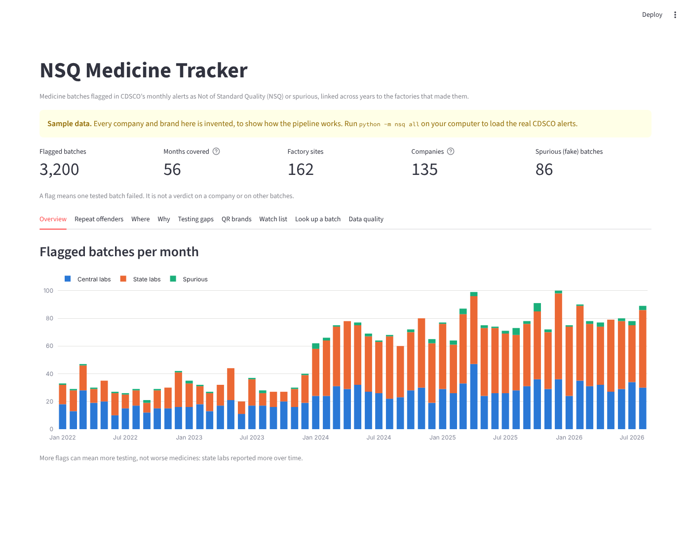
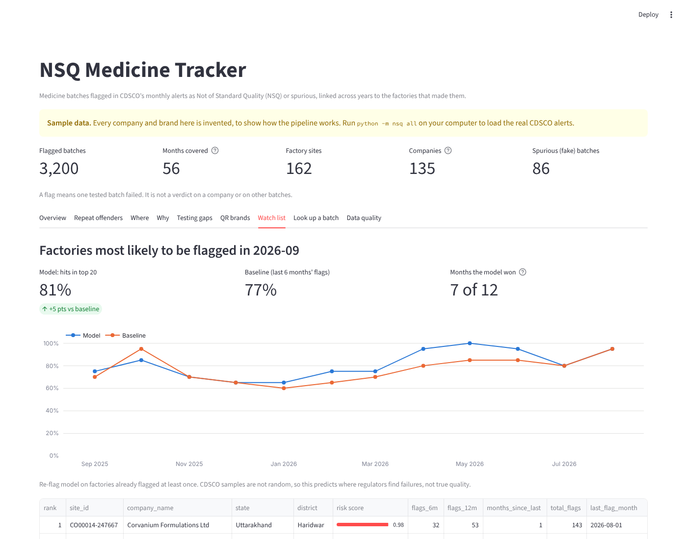
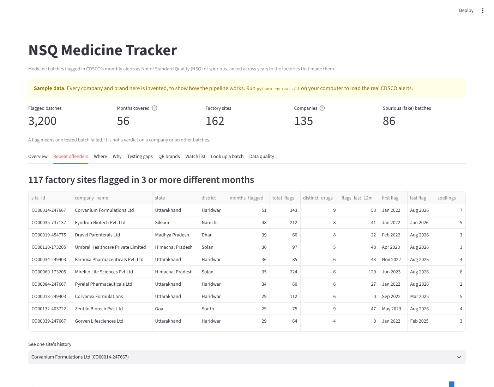
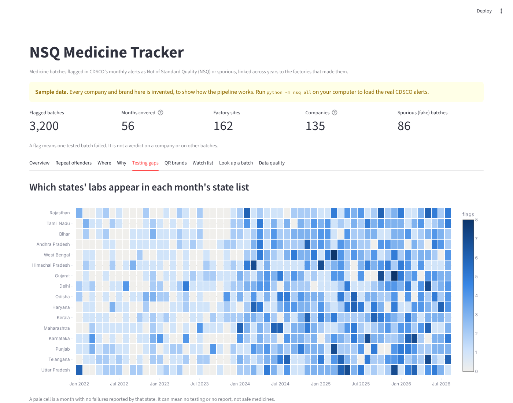

# NSQ Medicine Tracker

India's drug regulator (CDSCO) publishes a monthly list of medicine batches that failed quality tests ("Not of Standard Quality", NSQ) or turned out to be fakes ("spurious"). Each list covers one month, the format has changed over the years, and the same manufacturer is spelled many different ways.

This project builds a pipeline that collects years of those lists, parses the PDFs, cleans and links every manufacturer spelling to one factory, and loads it all into a small warehouse. On top of that it adds a dashboard and a model that ranks which factories are likely to be flagged again.

```
CDSCO Alerts page (PDFs, 2014 to Jul 2025) ─┐
CDSCO NSQ portal (Aug 2025 on, JSON)        ├─► raw store ─► parse ─► clean ─► link factories ─► DuckDB warehouse
"Samples declared NSQ 2017-2023" (PDF)     ─┘   (manifest)  (PDF       (names, PIN,   (fuzzy match,     (staging ─► marts)
                                                             tables)    state, drug)   union-find)            │
                                                                                                ┌─────────────┼──────────────┐
                                                                                         quality checks   re-flag model   Streamlit / Power BI
```

## Quick start: the demo (no internet needed, about a minute)

The demo generates **sample PDFs that copy CDSCO's real formats**, with invented companies and brands, and runs the whole pipeline on them.

Windows (PowerShell):

```powershell
cd nsq-tracker
py -m venv .venv
.venv\Scripts\Activate.ps1
pip install -r requirements.txt
python -m nsq demo
streamlit run app/dashboard.py -- --data-dir data_demo
```

Mac:

```bash
cd nsq-tracker
python3 -m venv .venv && source .venv/bin/activate
pip install -r requirements.txt
python -m nsq demo
streamlit run app/dashboard.py -- --data-dir data_demo
```

Everything the demo shows is labelled **SAMPLE**. Never quote sample numbers as findings.

| Overview | Watch list (model vs baseline) |
| --- | --- |
|  |  |
| **Repeat offenders** | **Testing gaps** |
|  |  |

*Screenshots show the sample data (invented companies).*

## Run it on the real data

```powershell
python -m nsq collect --limit 5     # test run: index the Alerts page, download the 5 newest lists
python -m nsq collect               # all drug-quality lists from 2019 (add --start-year 2014 for more)
python -m nsq build                 # parse -> clean -> link -> warehouse -> checks -> model -> exports
streamlit run app/dashboard.py
```

The downloader waits 3 seconds between files and skips files it already has, so a re-run only fetches new months. Expect a few hundred PDFs.

CDSCO's download links don't return the PDF directly. They return a small HTML page that links to the real file, and the downloader follows that link (the final address goes into `pdf_url` in the manifest). If a file still isn't a PDF, the page it got is saved in `data/raw/not_pdf/` so you can see what the site sent.

### Lists from August 2025 onward (the NSQ portal)

From August 2025, CDSCO publishes alerts in a web app at <https://cdscoonline.gov.in/CDSCO/viewPublicNSQDrug> instead of PDFs. Its data address isn't documented, so you capture it once per month:

1. Open the portal in Chrome and press F12. Open the **Network** tab and tick **Fetch/XHR**.
2. Pick a year and month and click **Apply Filter**.
3. Click the request that returned the table. Either right-click it, choose **Copy response**, and save the text as `data/raw/portal/portal_2025-08.json`, or use **Export HAR** and save the `.har` file into `data/raw/portal/`.
4. Run `python -m nsq build`. The adapter maps the field names automatically. If a column comes out empty, add the portal's field name to `SYNONYMS` in `nsq/portal.py`.

### First real run: what to check

The parser was built against CDSCO's documented column layouts and tested on sample PDFs that copy them. Real PDFs will have surprises, so check these before trusting any number:

- **Data quality tab** (or `data/exports/quality_report.csv`): every check should say PASS.
- **`data/interim/doc_summary.csv`**: `count_check = mismatch` means the parsed rows don't match the totals the PDF states. Open that PDF and see what was missed.
- **Pages without tables** (scanned pages or lists with no cell borders): re-run with `python -m nsq parse --llm` (needs `pip install anthropic` and an `ANTHROPIC_API_KEY`). The LLM only copies values, and any row whose batch number and drug name aren't on the page is thrown away.
- **Matching accuracy**: open `data/exports/match_review_sample.csv`, fill the `correct` column with yes/no for each pair, then run `python -m nsq score-review`.
- **QR brands**: `data/reference/qr_brands.csv` holds a partial list from press coverage. Replace it with the full Schedule H2 list from the gazette notification of 17 November 2022.

## Outputs

| File | What it is |
| --- | --- |
| `data/warehouse/nsq.duckdb` | The warehouse. Open it with DuckDB, DBeaver, or Python |
| `data/exports/powerbi/*.csv, *.parquet` | Every mart table for Power BI. Relate `fct_flags.site_id` to `dim_site.site_id` |
| `data/exports/findings.md` | Headline numbers, each from a named table |
| `data/exports/quality_report.csv` | PASS / WARN / FAIL for every data check |
| `data/exports/model_metrics.json`, `model_monthly.csv` | Model vs baseline, month by month |
| `data/exports/watch_list.csv` | Factories ranked by risk for next month |
| `data/exports/match_review_sample.csv` | 100 manufacturer pairs for you to hand-check |

## The numbers to report

| Metric | Where it comes from |
| --- | --- |
| Parsing completeness | `quality_report.csv`: files whose parsed rows match the PDF's stated totals |
| Matching accuracy | `python -m nsq score-review` after you hand-check 100 pairs |
| Prediction lift | `model_metrics.json`: precision@20 for the model vs the 6-month baseline over the last 12 months |
| Freshness | Days from CDSCO publishing a month to it appearing in the dashboard |

On the sample data the pipeline parses 24 of 24 lists with stated totals completely, matches companies with a B-cubed F1 of about 0.99 against the answer key, and the model's precision@20 is 0.81 against the baseline's 0.77. **Those are sample numbers.** Real data will be messier; report what your real run shows.

## Project layout

```
nsq/
  scrape_index.py   Alerts page -> index of every list, classified by title
  download.py       polite downloader + manifest (size, SHA-256)
  portal.py         NSQ portal JSON / HAR -> standard rows
  parse_pdf.py      PDF tables -> standard rows (old and new formats), stated-total checks
  llm_fallback.py   optional: rows from pages without tables, grounded and logged
  clean.py          manufacturer, drug, failure reason, lab; revised lists
  geo.py            PIN code / address -> state and district
  entities.py       fuzzy matching + union-find -> companies and factory sites
  warehouse.py      loads DuckDB and runs sql/01_staging, 02_intermediate, 03_marts
  quality.py        data checks (PASS / WARN / FAIL)
  model.py          re-flag model, time-based test, baseline, watch list
  export.py         Power BI exports
  report.py         findings.md
  sample.py         sample-data generator (invented companies)
app/dashboard.py    Streamlit dashboard
flows/monthly_flow.py  monthly run with Prefect (or Task Scheduler / cron)
tests/              pytest: parsing, cleaning, matching, end to end
```

## Tests

```bash
python -m pytest -m "not slow"   # unit tests, a few seconds
python -m pytest                 # adds the full demo pipeline (about a minute)
```

## Rules and limitations

- A flag means **one tested batch** failed. The health ministry stresses that a failure applies only to that batch, so the tool says "flagged in a CDSCO alert", never "bad company", and every row links to its source PDF.
- Samples are picked from sales and distribution points, not at random. A high count can mean more testing, not worse quality.
- Some states send no data in some months. A gap means "no report", not "no failures".
- Spurious batches carry an innocent company's name, so they never count against that company.
- The model only covers factories that have been flagged before (there is no data on the rest), and it predicts where regulators **find** failures, not true quality.
- Be polite to the government servers: keep the delay between requests and cache every file.

## Sources

- [CDSCO Alerts page](https://cdsco.gov.in/opencms/opencms/en/Notifications/Alerts/)
- [CDSCO NSQ portal](https://cdscoonline.gov.in/CDSCO/viewPublicNSQDrug)
